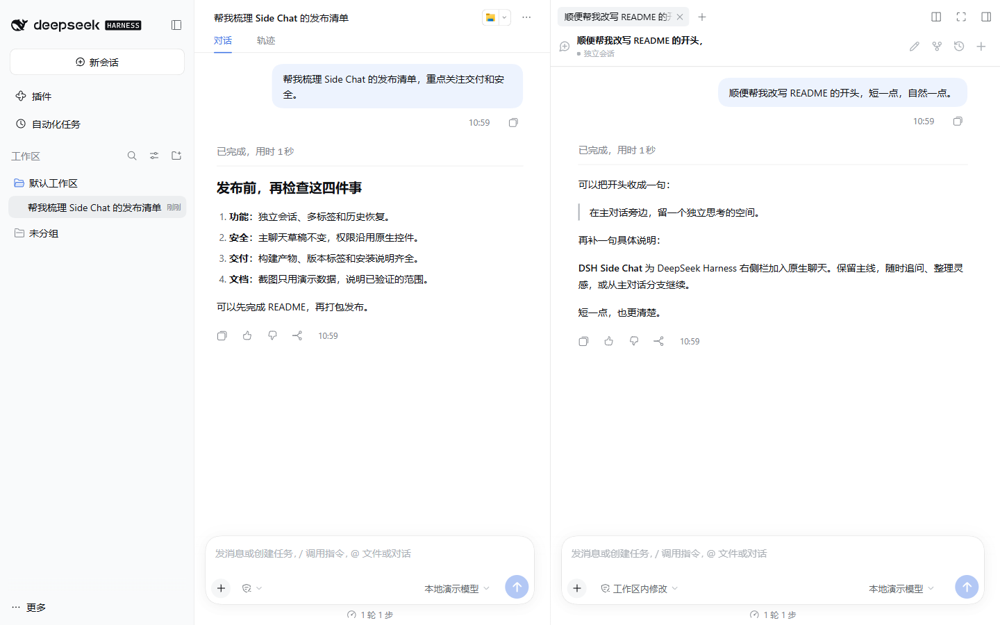
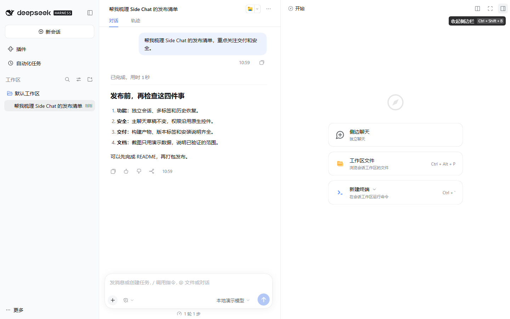
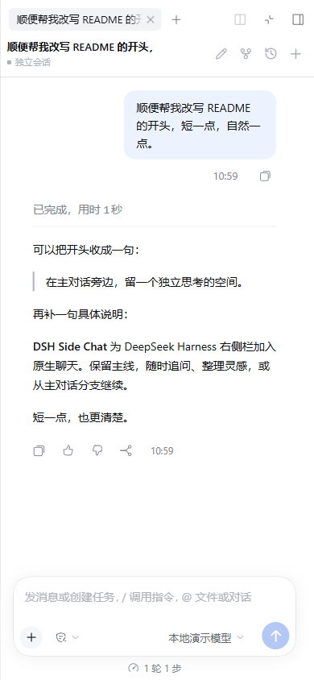

# DSH Side Chat

**主线不停，灵感另开一窗。** 在 DeepSeek Harness 右侧栏开启独立会话，延续原生聊天体验，同时让主对话保持原样。

[](https://github.com/Jensen-Yao/dsh-side-chat/releases)
[](https://github.com/Jensen-Yao/dsh-side-chat/actions/workflows/ci.yml)
[](LICENSE)

[项目主页](https://jensen-yao.github.io/dsh-side-chat/) · [English](README.en.md) · [版本与下载](https://github.com/Jensen-Yao/dsh-side-chat/releases) · [反馈问题](https://github.com/Jensen-Yao/dsh-side-chat/issues)



<p align="center"><sub>隔离环境中的固定演示数据，不含真实会话内容。</sub></p>

## 为什么做它

查一个问题、整理思路或从当前对话分出一条支线时，不必打断主聊天。Side Chat 把独立会话放在 DSH 原生右侧栏里，继续使用 Harness 自己的模型、工具、附件、权限和消息界面。

## 功能

| | 能做什么 |
| --- | --- |
| 独立会话 | 新建多个侧边会话并在标签间切换；主会话的选择和草稿保持不变。 |
| 原生聊天 | 使用 DSH 官方 Conversation Factory 与 composer，沿用当前 Harness 提供的模型、工具、附件和权限控件。 |
| 历史管理 | 搜索、置顶、重命名和刷新后恢复侧边标签。 |
| 从主会话分支 | 手动 fork 主会话，把官方 fork 接口支持的上下文带入新会话。 |
| 灵活查看 | 使用 DSH 右侧栏自带的拆分、收起和全屏布局。 |



## 安装

需要 DeepSeek Harness `0.2.1-rc.2` 或更新版本，并且该版本提供本插件使用的右侧栏与会话 UI 接口。先在 DSH 插件市场或插件设置中安装 GitHub Release：

```text
github:Jensen-Yao/dsh-side-chat#v0.1.0
```

也可以下载 [`dsh-side-chat-0.1.0.tgz`](https://github.com/Jensen-Yao/dsh-side-chat/releases/download/v0.1.0/dsh-side-chat-0.1.0.tgz)，在支持本地包的插件管理界面安装。安装后，在当前 profile 的插件设置中启用 **DSH Side Chat**，再按 Harness 提示重新加载插件。

如果通过命令行管理 profile，`dsh plugin --profile <profile> add <包>` 只负责安装依赖；还需在该 profile 的 `dsh.profile.bundles` 中保留现有条目并加入 `dsh-side-chat`，再让 Harness 加载该 bundle。桌面版请在桌面应用自己的插件管理界面操作，不要用 Web profile 代替。

更新时使用插件市场的更新操作，或安装新的固定版本。不要删除 profile lockfile、清空 `node_modules` 或批量升级其他插件来解决单个插件问题。

## 使用

在主工作区右侧栏的开始页中，选择 **侧边聊天**。点击新建按钮可增加标签；历史按钮可检索、置顶或重命名记录。需要承接当前任务时，使用会话工具栏里的 fork 操作；Side Chat 不会隐式复制主聊天上下文。

手机屏幕下，DSH 的侧栏布局仍由 Harness 控制；关闭或收起侧栏不会删除会话记录。



## 数据与权限

- 消息和执行记录由 DeepSeek Harness 的官方会话服务保存。
- 浏览器只保存用于恢复标签的会话 ID、标签名称、创建时间和置顶状态；历史索引按页面 origin 隔离，Web 与桌面窗口不会自动共享这份索引。
- 移除一条历史索引不会删除 Harness 会话。关闭标签也不会取消仍在运行的任务；要停止生成，请使用该会话自己的停止按钮。
- 插件没有单独的模型 API 密钥或直连模型请求，也不会自动扩大权限。模型、工具和授权继续由 Harness 管理。
- 插件使用公开的 DSH UI 和会话接口，不通过修改核心文件或查找内部 DOM 节点接入。

## 兼容性与已验证范围

| 环境 | 状态 |
| --- | --- |
| DSH Web `0.2.1-rc.2`，隔离演示 profile | 已验证新建、流式回复、停止、fork、多标签和刷新恢复。 |
| Web 窄屏布局 | 已检查 390 × 844 视口。 |
| DSH 桌面版 | profile 已配置；原生桌面窗口尚未完成独立交互验证。 |
| 更高版本的 DSH | 需公开接口保持兼容；若加载失败，请附上 DSH 版本与导出的日志提交 Issue。 |

## 从源码构建

```sh
npm ci
npm run typecheck
npm test
npm run build
```

构建输出位于 `lib/`，仓库和发布包均包含这些产物。详细开发说明见 [DEVELOPMENT.md](DEVELOPMENT.md)，已执行验证记录见 [VERIFICATION.md](VERIFICATION.md)。

## 项目

- [GitHub Pages](https://jensen-yao.github.io/dsh-side-chat/)
- [源码与 Releases](https://github.com/Jensen-Yao/dsh-side-chat)
- [DeepSeek Harness](https://github.com/deepseek-ai/deepseek-harness)（本插件是独立社区项目，与官方无隶属关系）
- [MIT License](LICENSE)
